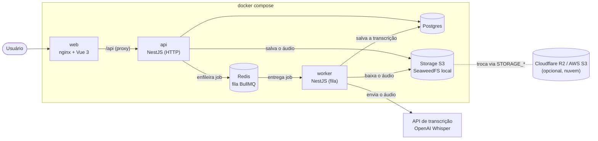
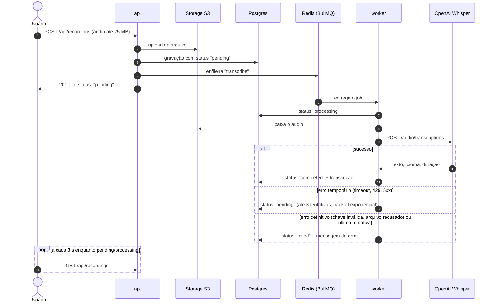
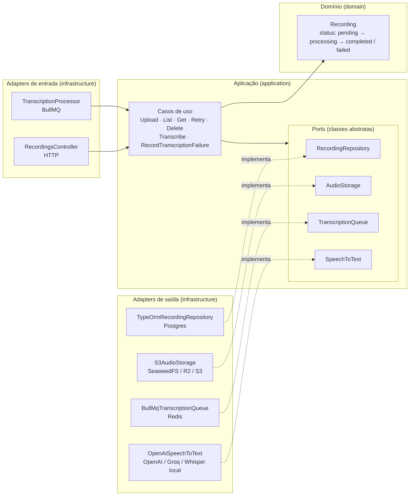

# Platform Attorney

Monorepo (pnpm workspaces) com:

| Pasta       | Stack                                                                            |
| ----------- | -------------------------------------------------------------------------------- |
| `apps/api`  | NestJS 12 (ESM) + TypeORM + PostgreSQL, validação com class-validator             |
| `apps/web`  | Vue 3 + TypeScript + Composition API (`<script setup>`), Vite, Tailwind CSS v4, Vue Router, Axios |

A API também tem um **worker** (mesmo código, outro processo) que transcreve áudios com Whisper.

## Arquitetura

### Visão geral



API e worker são o **mesmo código** (`apps/api`) com dois entrypoints: `main.ts` (HTTP) e `worker.ts` (consumidor da fila).

### Fluxo de upload e transcrição



### Camadas da API (Clean Architecture / Ports and Adapters)

Cada contexto (`clients`, `recordings`) é dividido em camadas, e **as dependências sempre apontam para dentro**: o domínio não conhece ninguém; a aplicação só conhece o domínio e as interfaces (ports); a infraestrutura implementa essas interfaces. O diagrama mostra o contexto `recordings`:



| Camada | Conteúdo | Pode depender de |
| --- | --- | --- |
| `domain/` | Entidades com as regras de negócio (ex.: quando uma gravação pode ser reprocessada) e erros de domínio | Nada além da biblioteca padrão do Node |
| `application/` | Casos de uso (`*.use-case.ts`) e **ports** (`ports/`): classes abstratas para tudo o que vem de fora | `domain` |
| `infrastructure/` | **Adapters**: TypeORM, S3, BullMQ, OpenAI (saída) e controllers HTTP / processor da fila (entrada) | `application`, `domain`, frameworks |
| `*.module.ts` | Composition root: liga cada port ao seu adapter | Tudo |

- **Trocar uma tecnologia é escrever um adapter**: outro serviço de transcrição, por exemplo, é uma nova classe que estende `SpeechToText` mais uma linha no módulo. Os casos de uso não mudam.
- **Erros de domínio** (`NotFoundError`, `ConflictError`) são traduzidos para 404/409 pelo `DomainErrorFilter`; os casos de uso não conhecem HTTP.
- **Testes**: os casos de uso rodam com adapters em memória, sem banco, Redis, S3 ou Nest.

### Detalhes de infraestrutura

- Storage via [`@nestjs/storage`](https://docs.nestjs.com/application/file-storage) (`S3Disk`): o mesmo código fala com qualquer storage compatível com S3. Trocar de provedor é só mudar as variáveis `STORAGE_*`.
- Fila via [`@nestjs/bullmq`](https://docs.nestjs.com/application/queues): 3 tentativas com backoff exponencial. Erros que não melhoram com retry (chave inválida, arquivo inválido) falham na hora.
- Transcrição via qualquer API no formato da OpenAI (`/audio/transcriptions`). O padrão é a OpenAI; trocar de provedor é só mudar as variáveis `STT_*`.
- Upload limitado a **25 MB**, o limite de arquivo da API de transcrição.

## Subir tudo com Docker

```bash
cp .env.example .env        # preencha STT_API_KEY (veja abaixo)
docker compose up -d --build
```

| Serviço       | URL / porta                                           |
| ------------- | ----------------------------------------------------- |
| Frontend      | http://localhost:8080 (página **Gravações**)          |
| API           | http://localhost:3000/api                             |
| Health        | http://localhost:3000/api/health                      |
| Swagger       | http://localhost:3000/api/docs (JSON em `/api/docs-json`) |
| Postgres      | `localhost:5432` (postgres/postgres)                  |
| Storage S3    | `http://localhost:8333` (devaccesskey/devsecretkey)   |
| Redis         | `localhost:6379`                                      |

Por padrão, o storage é o **SeaweedFS local**: um servidor compatível com S3 rodando no próprio docker-compose. Os arquivos ficam no volume `storagedata`, no seu PC, sem conta nem custo. O serviço `storage-init` cria o bucket na primeira subida.

### Testar pela linha de comando

```bash
curl -F file=@minha-gravacao.m4a http://localhost:3000/api/recordings   # → status "pending"
curl http://localhost:3000/api/recordings/<id>                           # até status "completed"
```

### Endpoints

A documentação completa e interativa (com schemas, exemplos e "Try it out", inclusive o upload) está no **Swagger**: http://localhost:3000/api/docs, também acessível pelo frontend em http://localhost:8080/api/docs. O JSON OpenAPI em `/api/docs-json` pode gerar clientes HTTP. Para desligar, por exemplo em produção, use `SWAGGER_ENABLED=false`.

| Método | Rota                          | Descrição                                     |
| ------ | ----------------------------- | --------------------------------------------- |
| POST   | `/api/recordings`             | Upload (multipart, campo `file`, só áudio)    |
| GET    | `/api/recordings`             | Lista gravações com status e transcrição      |
| GET    | `/api/recordings/:id`         | Detalhe de uma gravação                       |
| GET    | `/api/recordings/:id/audio`   | Streaming do áudio (suporta Range)            |
| POST   | `/api/recordings/:id/retry`   | Reenfileira uma gravação que falhou           |
| DELETE | `/api/recordings/:id`         | Apaga o arquivo do storage e o registro       |

## Chave da OpenAI (transcrição)

1. Crie uma conta em https://platform.openai.com e adicione um cartão em **Settings → Billing**. A API é paga por uso: o `whisper-1` custa cerca de US$0,006 por minuto de áudio, então 1 hora sai por uns US$0,36.
2. Ainda em **Billing → Limits**, defina um limite de gasto mensal baixo (ex.: US$5) para não ter surpresas.
3. Em **API keys** → **Create new secret key**, crie a chave e copie-a. Ela só aparece uma vez.
4. No `.env`: `STT_API_KEY=sk-...`, depois rode `docker compose up -d worker`.
5. Opcional: `TRANSCRIPTION_LANGUAGE=pt` fixa o idioma (melhora a precisão). `STT_MODEL=gpt-4o-mini-transcribe` costuma ser mais barato, mas não devolve idioma nem duração.

Sem a chave, as gravações ficam com status `failed` e a mensagem `STT_API_KEY não configurada`. Depois de configurar, use "Tentar de novo".

**Outros provedores compatíveis**: basta mudar `STT_BASE_URL`, `STT_API_KEY` e `STT_MODEL`. Por exemplo, a Groq (plano gratuito) usa `STT_BASE_URL=https://api.groq.com/openai/v1` e `STT_MODEL=whisper-large-v3`; um Whisper local compatível com a API da OpenAI usa a URL do container.

## Usar o Cloudflare R2 (storage na nuvem, 10 GB grátis)

1. Crie uma conta em https://dash.cloudflare.com. Ao ativar o R2, pode ser pedido um cartão só para verificação; o uso dentro do plano gratuito não é cobrado.
2. No menu, vá em **R2 Object Storage** → **Create bucket**. Dê um nome (ex.: `platform-attorney-recordings`) e mantenha a classe de armazenamento **Standard**: o plano gratuito não cobre Infrequent Access.
3. Na página do R2, abra **Manage API Tokens** → **Create API Token**:
   - Permissão: **Object Read & Write**
   - Escopo: **apenas o bucket criado**
4. Copie o **Access Key ID**, o **Secret Access Key** e o endpoint `https://<ACCOUNT_ID>.r2.cloudflarestorage.com`. O secret só aparece uma vez.
5. No `.env`:

   ```env
   STORAGE_ENDPOINT=https://<ACCOUNT_ID>.r2.cloudflarestorage.com
   STORAGE_REGION=auto
   STORAGE_BUCKET=platform-attorney-recordings
   STORAGE_ACCESS_KEY_ID=<access key id>
   STORAGE_SECRET_ACCESS_KEY=<secret access key>
   STORAGE_FORCE_PATH_STYLE=false
   ```

6. Rode `docker compose up -d` de novo. A API e o worker passam a usar o R2; os serviços `storage` e `storage-init` continuam subindo, mas ficam sem uso.

Plano gratuito do R2: 10 GB armazenados por mês, 1 milhão de escritas e 10 milhões de leituras por mês, e download (egress) sempre grátis.

## Alternativa: AWS S3

1. Em https://console.aws.amazon.com/s3, clique em **Create bucket**. Escolha a região (ex.: `sa-east-1`) e mantenha **Block all public access** ligado.
2. Em **IAM** → **Users** → **Create user** (ex.: `platform-attorney-app`), sem acesso ao console.
3. Anexe uma política inline restrita ao bucket:

   ```json
   {
     "Version": "2012-10-17",
     "Statement": [
       {
         "Effect": "Allow",
         "Action": ["s3:PutObject", "s3:GetObject", "s3:DeleteObject"],
         "Resource": "arn:aws:s3:::SEU-BUCKET/*"
       }
     ]
   }
   ```

4. No usuário, abra **Security credentials** → **Create access key** (tipo "Application running outside AWS").
5. No `.env`: `STORAGE_ENDPOINT=https://s3.sa-east-1.amazonaws.com`, `STORAGE_REGION=sa-east-1`, `STORAGE_FORCE_PATH_STYLE=false`, e preencha o bucket e as chaves. Não deixe o endpoint vazio: vazio significa "storage local".

Contas novas da AWS recebem créditos gratuitos que expiram (o plano Free dura cerca de 6 meses). Depois disso o S3 passa a ser cobrado. Configure um alerta de orçamento em **Billing**.

### Modo desenvolvimento no Docker (hot reload)

```bash
docker compose -f docker-compose.yml -f docker-compose.dev.yml up --build
```

O frontend fica em http://localhost:5173 (Vite/HMR). A API e o worker rodam com `nest start --watch`.

## Desenvolvimento local (sem Docker para os apps)

```bash
pnpm install
docker compose up -d db redis storage storage-init   # só a infraestrutura
pnpm dev                                             # API (3000) + worker + Web (5173)
```

## Scripts úteis

```bash
pnpm build                  # build de todos os apps
pnpm test                   # testes unitários da API (Vitest)
pnpm lint
pnpm dev:worker             # só o worker de transcrição

# Migrations (TypeORM), dentro de apps/api
pnpm --filter api migration:generate src/database/migrations/NomeDaMigration
pnpm --filter api migration:create src/database/migrations/NomeDaMigration
pnpm --filter api migration:run
pnpm --filter api migration:revert
```

## Estrutura

Veja as camadas em [Camadas da API](#camadas-da-api-clean-architecture--ports-and-adapters).

```
apps/
  api/src/
    config/                     # database, storage (S3) e fila (Redis)
    database/                   # DataSource da CLI + migrations
    shared/
      domain/                   # erros de domínio base
      infrastructure/           # InfraModule (banco, storage, fila) + filtro HTTP
    clients/                    # contexto de exemplo (CRUD)
      domain/ application/ infrastructure/ clients.module.ts
    recordings/                 # upload, streaming e transcrição de áudios
      domain/                   # Recording + erros
      application/ports/        # RecordingRepository, AudioStorage, TranscriptionQueue, SpeechToText
      application/use-cases/    # upload, list, get, retry, delete, transcribe, record-failure
      infrastructure/           # persistence/ storage/ queue/ stt/ http/
      recordings.module.ts      # composition root da API HTTP
      recordings-worker.module.ts  # composition root do worker
    main.ts                     # entrypoint HTTP
    worker.ts                   # entrypoint do worker
  web/
    PRODUCT.md                  # para quem é o produto, tom e princípios de design
    DESIGN.md                   # sistema de design: fontes, cores, espaços, componentes
  web/src/
    style.css                   # tema do Tailwind (tokens do DESIGN.md) + componentes
    services/                   # cliente HTTP (axios)
    composables/                # useClients, useRecordings (com polling)
    views/                      # ClientsView, RecordingsView
infra/seaweedfs/s3.json         # credenciais do storage local (só dev)
docker-compose.yml              # db + storage + redis + api + worker + web
docker-compose.dev.yml          # override de desenvolvimento
```
